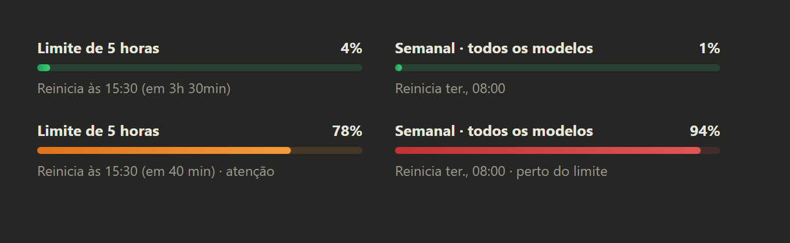

# Painel de uso para o Claude Code

Um painel fixo, logo acima da caixa de mensagem do Claude Code, que mostra o tempo todo quanto você já usou do seu plano Claude, sem precisar abrir o menu de uso:

- **Limite de 5 horas**: a porcentagem usada e quando a janela reinicia (com contagem regressiva).
- **Semanal · todos os modelos**: a porcentagem usada e o dia e a hora em que reinicia.



## Cores

| Cor | Quando | O que significa |
| --- | --- | --- |
| Verde | até 74% | uso tranquilo |
| Laranja | de 75% a 89% | se aproximando do limite (aparece "· atenção") |
| Vermelho | 90% ou mais | no limite ou muito perto (aparece "· perto do limite") |

## Como funciona

- O painel consulta, ao abrir a conversa e a cada minuto, os mesmos números do menu de uso do app, usando o seu login do Claude. É o próprio Claude Code que coloca a credencial na consulta, então o painel nunca vê seu token.
- Todas as conversas abertas compartilham a leitura mais recente: só uma delas consulta por minuto, e as outras pegam o resultado em até 20 segundos.
- Se a consulta falhar, o painel mostra a última leitura com a idade dela (por exemplo, "Leitura de 40 min atrás"), para nunca passar um número velho como atual.
- No app desktop, cada limite aparece como uma barra fina e arredondada; no terminal, como uma linha `━━━───` colorida.
- Também fixa uma linha de status curta, por exemplo `Uso: 5h 32% · Semana 8%`.
- O comando `/uso` esconde ou mostra o painel. O botão `[-]` do painel também o recolhe.

Funciona com assinatura Claude (Pro ou Max). Com chave de API não há limites de 5 horas ou semanais, então o painel fica vazio.

O painel aparece nas conversas iniciadas depois da instalação. Uma conversa que já estava aberta passa a mostrá-lo quando é reaberta.

## Instalação

Num terminal com o Claude Code aberto, digite:

```
/plugin install painel-uso --marketplace NatanSAlbino/painel-uso
```

Responda `y` para adicionar o marketplace e escolha o escopo **user** (vale para todas as sessões).

Ou, direto do shell:

```bash
claude plugin install painel-uso --marketplace NatanSAlbino/painel-uso
```

No app desktop do Claude (aba Code), onde `/plugin` não funciona: clique em **+** ao lado da caixa de mensagem, depois em **Plugins** → **Add marketplace** com `NatanSAlbino/painel-uso` → **Add plugin**. Um mod instalado pelo terminal no escopo user também aparece no app desktop.

## Atualizar

```bash
claude plugin marketplace update painel-uso
claude plugin update painel-uso@painel-uso
```

## Desinstalar

```bash
claude plugin uninstall painel-uso
```
